# ARCHITECTURE.md - Technical Architecture Document

## Overview

**intelli-bru** is a JetBrains IntelliJ Platform Plugin providing comprehensive IDE support for Bruno API collections. This document describes the technical architecture, design decisions, and technology choices.

---

## Table of Contents

1. [System Architecture](#system-architecture)
2. [Technology Stack](#technology-stack)
3. [Design Decisions](#design-decisions)
4. [Module Structure](#module-structure)
5. [Language Support Architecture](#language-support-architecture)
6. [CLI Integration Architecture](#cli-integration-architecture)
7. [Data Models](#data-models)
8. [Service Layer](#service-layer)
9. [UI Architecture](#ui-architecture)
10. [Extension Points](#extension-points)
11. [Security Considerations](#security-considerations)
12. [Performance Considerations](#performance-considerations)

---

## 1. System Architecture

### High-Level Architecture

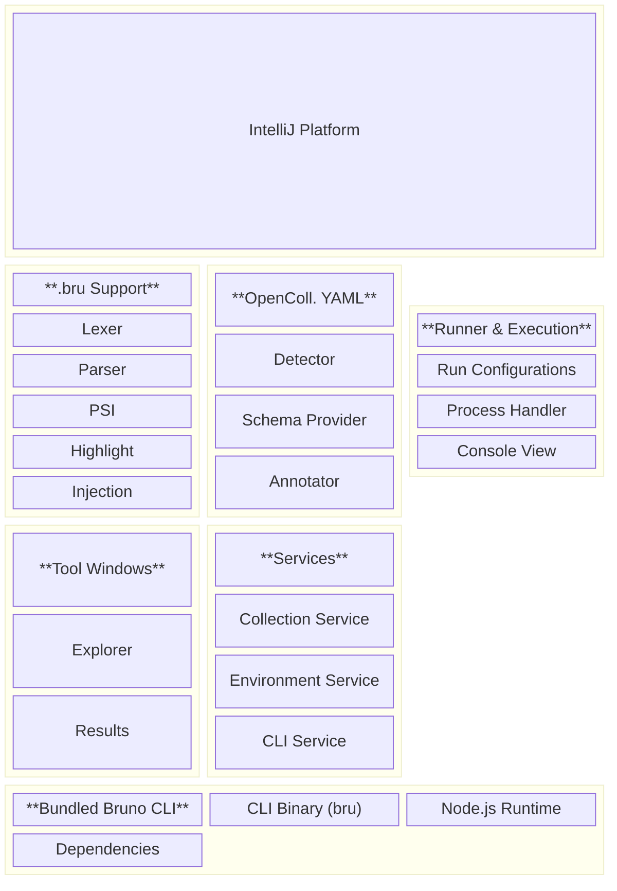

### Component Interaction Flow

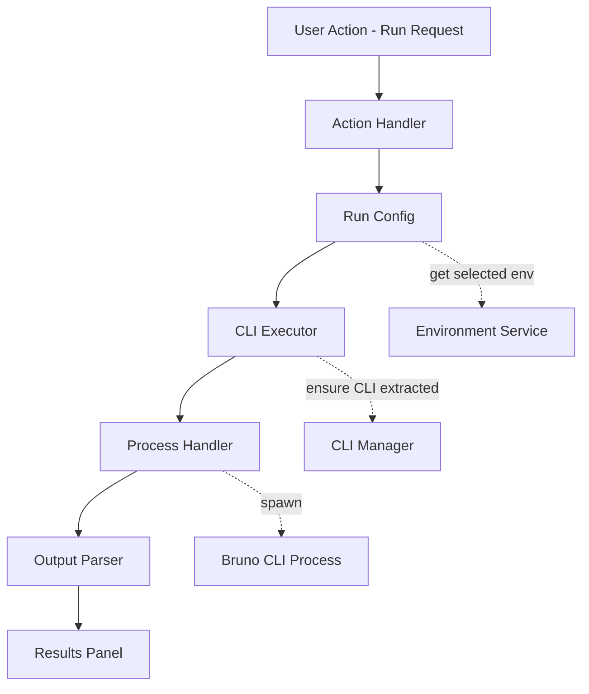

---

## 2. Technology Stack

### Core Technologies

| Technology | Version | Purpose |
|------------|---------|---------|
| Kotlin | 2.1.20 | Primary language |
| JVM | 21 | Runtime target |
| Gradle | 9.0.0 | Build system |
| Gradle Kotlin DSL | - | Build configuration |

### IntelliJ Platform

| Component | Version | Purpose |
|-----------|---------|---------|
| IntelliJ Platform | 2025.2.4+ | Plugin host |
| IntelliJ Platform Gradle Plugin | 2.10.2 | Build integration |
| Kotlin Compose Plugin | 2.1.20 | UI framework support |

### UI Framework

| Technology | Purpose |
|------------|---------|
| Jetpack Compose | Modern declarative UI |
| Jewel Bridge | IntelliJ theming integration |
| Jewel UI Components | Native look-and-feel |

### Parser Generation

| Tool | Purpose |
|------|---------|
| Grammar-Kit | BNF grammar to parser/lexer |
| JFlex | Lexer specification |
| GrammarKit Gradle Plugin | Build-time generation |

### Bundled Dependencies

| Dependency | Purpose |
|------------|---------|
| Bruno CLI (@usebruno/cli) | Request execution |
| Node.js (embedded) | CLI runtime |
| Gson | JSON parsing |

### IntelliJ Platform Plugins (Dependencies)

| Plugin | Requirement | Purpose |
|--------|-------------|---------|
| YAML | Required | OpenCollection YAML support |
| JSON | Required | Schema validation, JSON bodies |
| JavaScript | Optional | Script block injection |
| Markdown | Optional | Docs block injection |

---

## 3. Design Decisions

### Decision 1: Parser Technology - Grammar-Kit

**Choice:** Grammar-Kit with JFlex

**Rationale:**
- Native IntelliJ Platform integration
- Generates PSI tree automatically
- Well-documented for IntelliJ plugin development
- Incremental parsing support
- Error recovery built-in

**Alternatives Considered:**
- ANTLR4: More powerful but adds complexity, requires separate integration
- Hand-written parser: Full control but significant development effort
- Ohm.js port: Would require JavaScript interop

### Decision 2: UI Framework - Jetpack Compose

**Choice:** Jetpack Compose with Jewel

**Rationale:**
- Modern declarative approach
- Already configured in the project
- Jewel provides native IntelliJ look-and-feel
- Better state management than Swing
- Easier to maintain and extend

**Alternatives Considered:**
- Swing: Traditional but verbose
- JavaFX: Not well integrated with IntelliJ

### Decision 3: CLI Integration - Bundled Binary

**Choice:** Bundle complete CLI with Node.js runtime

**Rationale:**
- Zero user configuration required
- Consistent behavior across environments
- No external dependencies for users
- Version-controlled CLI behavior

**Alternatives Considered:**
- npx: Requires npm/Node.js on system
- Global install requirement: Poor user experience
- HTTP client reimplementation: Massive scope, divergent behavior

### Decision 4: OpenCollection YAML - Schema-Based Validation

**Choice:** JSON Schema provider with YAML annotator

**Rationale:**
- Leverages IntelliJ's built-in JSON Schema support
- Automatic validation and completion
- Schema maintained by OpenCollection project
- Annotator for visual enhancements (HTTP method colors)

**Alternatives Considered:**
- Custom YAML parser: Duplicates platform functionality
- No validation: Poor developer experience

### Decision 5: Service Architecture - Project-Level Services

**Choice:** Project-scoped services for state management

**Rationale:**
- Each project can have different collections/environments
- Proper lifecycle management
- State isolation between projects

**Application-level services for:**
- Bundled CLI manager (shared resource)
- Plugin settings (global preferences)

### Decision 6: Language Injection Strategy

**Choice:** MultiHostInjector for embedded languages

**Rationale:**
- Platform-standard approach
- Automatic syntax highlighting in injected regions
- Code completion in injected regions
- Proper error highlighting

**Injection Mapping:**
| Block | Injected Language |
|-------|-------------------|
| body, body:json, body:graphql:vars | JSON |
| body:xml | XML |
| body:graphql | GraphQL (if available) |
| script:pre-request, script:post-response, tests | JavaScript |
| docs | Markdown |

---

## 4. Module Structure

### Package Organization

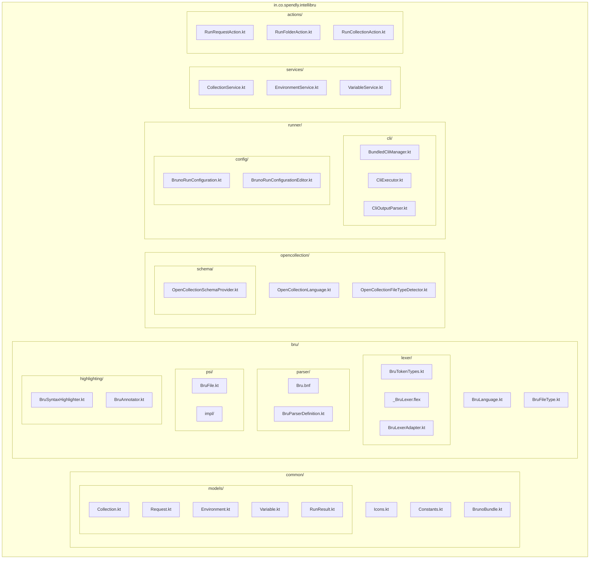

---

## 5. Language Support Architecture

### .bru File Language Stack

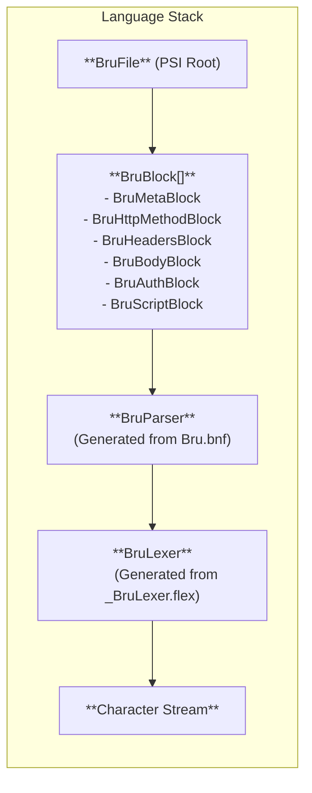

### Token Types

| Category | Tokens |
|----------|--------|
| Keywords | META, SETTINGS, GET, POST, PUT, DELETE, PATCH, OPTIONS, HEAD, CONNECT, TRACE, HTTP, GRPC, WS, QUERY, HEADERS, BODY, BODY_JSON, BODY_XML, ... |
| Structure | LBRACE, RBRACE, LBRACKET, RBRACKET, COLON, NEWLINE |
| Special | TILDE (disable), MULTILINE_DELIM (''') |
| Content | KEY, QUOTED_KEY, VALUE, TEXT_CONTENT |

### Highlighting Layers

1. **Lexer-based**: Keywords, braces, structural tokens
2. **Parser-based**: Error highlighting for syntax errors
3. **Annotator-based**: Variable references `{{var}}`, disabled items
4. **Injected**: JSON/JS/XML syntax in text blocks

### OpenCollection YAML Architecture

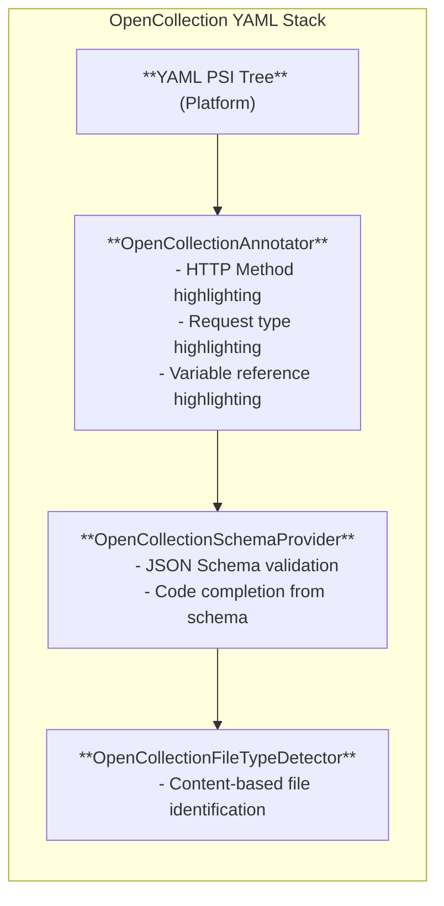

---

## 6. CLI Integration Architecture

### Bundled CLI Structure

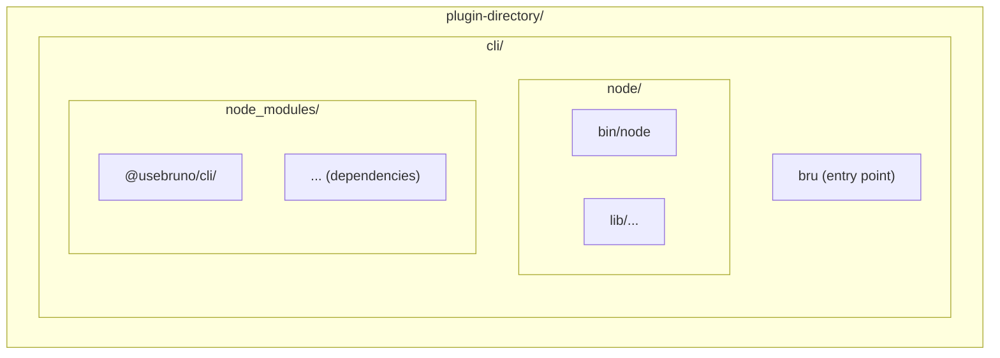

### CLI Execution Flow

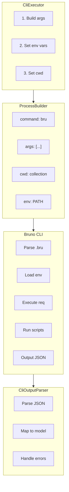

### CLI Arguments Mapping

| Plugin Option | CLI Argument |
|---------------|--------------|
| Target path(s) | `[paths...]` |
| Environment | `--env <name>` |
| Environment file | `--env-file <path>` |
| Variable overrides | `--env-var name=value` |
| Sandbox mode | `--sandbox safe\|developer` |
| Recursive | `-r` |
| Tests only | `--tests-only` |
| Stop on fail | `--bail` |
| Include tags | `--tags tag1,tag2` |
| Exclude tags | `--exclude-tags tag1,tag2` |
| JSON output | `--reporter-json <path>` |

### Exit Code Handling

| Exit Code | Meaning | Plugin Behavior |
|-----------|---------|-----------------|
| 0 | Success | Show success results |
| 1 | Test/assertion failure | Show failed results |
| 5 | File not found | Show error notification |
| 6 | Environment not found | Show error notification |
| 255 | Generic error | Show error with stderr |

---

## 7. Data Models

### Collection Model

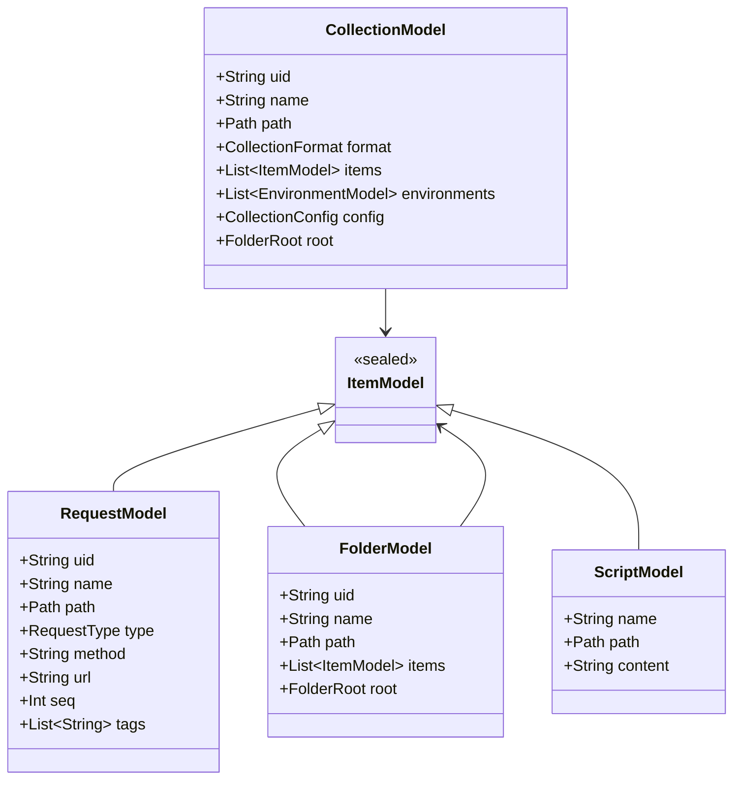

### Environment Model

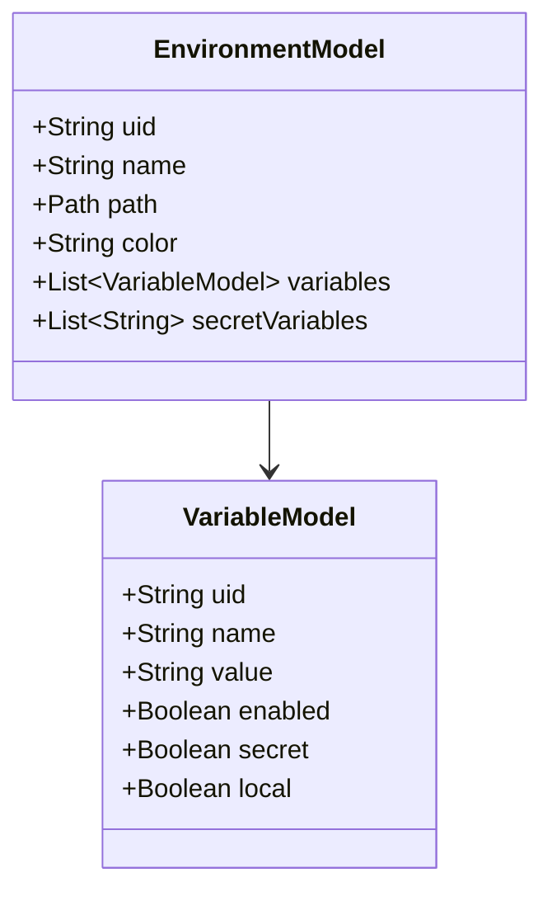

### Run Result Model

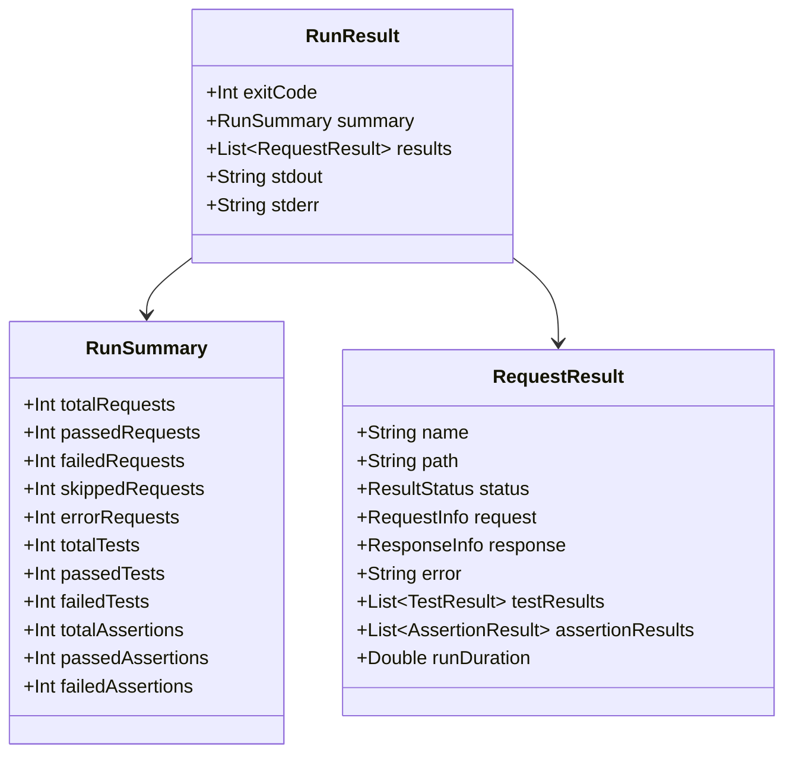

---

## 8. Service Layer

### Service Hierarchy

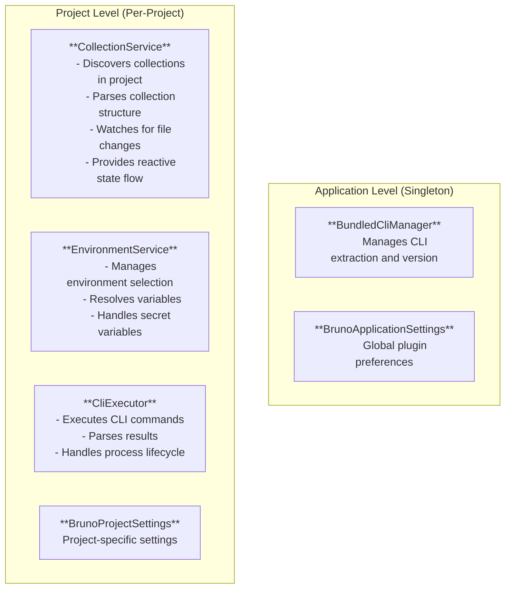

### Service Communication

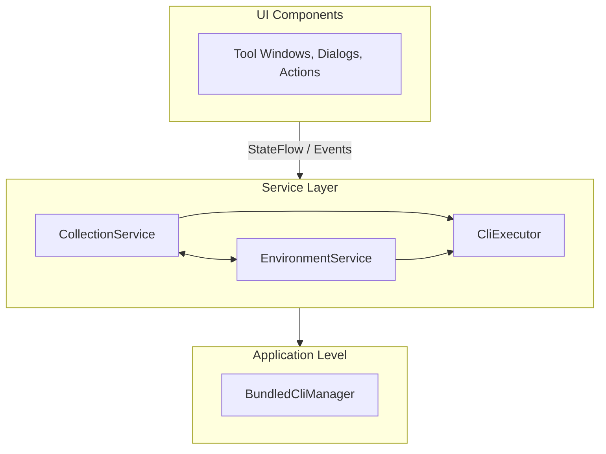

### Reactive State Management

Services expose state via Kotlin StateFlow:

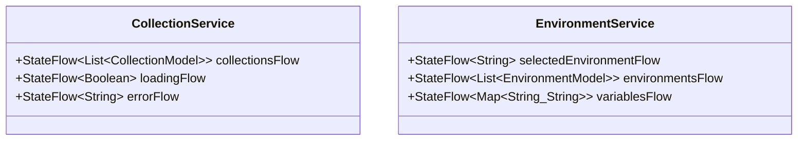

---

## 9. UI Architecture

### Compose Component Hierarchy

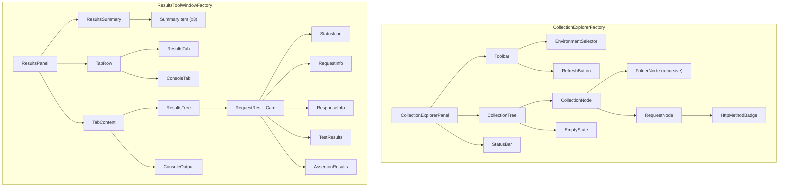

### State Management Pattern

```kotlin
@Composable
fun CollectionExplorerPanel() {
    // Collect state from services
    val service = LocalProject.current.service<CollectionService>()
    val collections by service.collectionsFlow.collectAsState()
    val loading by service.loadingFlow.collectAsState()
    
    // Local UI state
    var expandedNodes by remember { mutableStateOf(setOf<String>()) }
    var selectedNode by remember { mutableStateOf<String?>(null) }
    
    // Event handlers
    val onRefresh = { service.refresh() }
    val onNodeClick = { nodeId: String -> selectedNode = nodeId }
    
    // Render
    Column {
        if (loading) {
            LoadingIndicator()
        } else {
            CollectionTree(
                collections = collections,
                expandedNodes = expandedNodes,
                selectedNode = selectedNode,
                onNodeClick = onNodeClick,
                onNodeExpand = { expandedNodes = expandedNodes + it },
                onNodeCollapse = { expandedNodes = expandedNodes - it }
            )
        }
    }
}
```

### Theme Integration

Jewel bridge provides automatic theme synchronization:
- Colors adapt to IntelliJ theme (Light/Dark/High Contrast)
- Typography matches IDE fonts
- Component styling matches native IntelliJ components
- No manual theme switching required

---

## 10. Extension Points

### Registered Extensions

| Extension Point | Implementation | Purpose |
|-----------------|----------------|---------|
| `fileType` | BruFileType | .bru file registration |
| `lang.parserDefinition` | BruParserDefinition | PSI tree creation |
| `lang.syntaxHighlighterFactory` | BruSyntaxHighlighterFactory | Lexer-based highlighting |
| `colorSettingsPage` | BruColorSettingsPage | User color customization |
| `multiHostInjector` | BruLanguageInjector | Embedded language support |
| `fileTypeDetector` | OpenCollectionFileTypeDetector | YAML detection |
| `annotator` | OpenCollectionAnnotator | YAML semantic highlighting |
| `json.schemaProviderFactory` | OpenCollectionSchemaProvider | Schema validation |
| `configurationType` | BrunoRunConfigurationType | Run configuration |
| `runConfigurationProducer` | BrunoRunConfigurationProducer | Context menu runs |
| `toolWindow` | CollectionExplorerFactory | Explorer panel |
| `toolWindow` | ResultsToolWindowFactory | Results panel |
| `projectConfigurable` | BrunoSettingsConfigurable | Settings page |
| `projectService` | CollectionService, etc. | Project services |
| `applicationService` | BundledCliManager | App services |
| `notificationGroup` | Bruno | Notifications |

### Actions

| Action ID | Class | Description |
|-----------|-------|-------------|
| Bruno.RunRequest | RunRequestAction | Run single request |
| Bruno.RunFolder | RunFolderAction | Run folder recursively |
| Bruno.RunCollection | RunCollectionAction | Run entire collection |
| Bruno.NewRequest | NewRequestAction | Create new request |
| Bruno.OpenInBruno | OpenInBrunoAction | Open in Bruno desktop |

---

## 11. Security Considerations

### CLI Sandboxing

The Bruno CLI supports two sandbox modes:

| Mode | Runtime | Security Level | Use Case |
|------|---------|----------------|----------|
| safe | QuickJS WASM | High | Default, isolated execution |
| developer | Node.js VM | Medium | Access to local modules |

**Plugin default:** `safe` mode

### Sensitive Data Handling

1. **Secret Variables**: Never logged or displayed in full
2. **Environment Files**: User responsibility, plugin doesn't store
3. **Request History**: Not persisted by plugin
4. **CLI Output**: Sanitized before display (option to hide headers)

### Process Isolation

- CLI runs as separate process
- No direct network access from plugin
- File system access limited to collection directory
- Environment variables isolated per execution

---

## 12. Performance Considerations

### Lazy Loading

- Collections parsed on-demand
- PSI tree built incrementally
- Tool windows created lazily
- CLI extracted only when needed

### Caching Strategy

| Data | Cache Location | Invalidation |
|------|----------------|--------------|
| Parsed collections | In-memory | File change events |
| CLI path | Application storage | Version check |
| Environments | In-memory | File change events |
| Run results | Session only | Never persisted |

### Background Processing

| Operation | Thread | Progress |
|-----------|--------|----------|
| Collection scanning | Background | Indeterminate |
| CLI execution | IO thread | Console output |
| PSI parsing | Platform managed | None |
| File watching | Platform managed | None |

### Memory Management

- Use `WeakReference` for cached models
- Dispose services on project close
- Clear results on new run
- Limit console buffer size

---

## Appendix A: File Format Reference

### .bru File Grammar (Simplified)

```
bruFile     ::= block*
block       ::= keyword dictionary | keyword textBlock
dictionary  ::= '{' keyValue* '}'
keyValue    ::= '~'? key ':' value? NEWLINE
textBlock   ::= '{' TEXT* '}'
key         ::= QUOTED_KEY | KEY
value       ::= MULTILINE | LIST | VALUE
```

### OpenCollection YAML Schema (Key Structures)

```yaml
# Request file structure
info:
  name: string
  type: http | graphql | grpc | websocket
  seq: number
  tags: [string]

http:  # or graphql/grpc/websocket
  method: string
  url: string
  headers: [{name, value, disabled?}]
  params: [{name, value, type, disabled?}]
  body: {type, data}

runtime:
  variables: [{name, value, disabled?}]
  scripts: [{type, code}]
  assertions: [{expression, operator, value}]

settings:
  timeout: number
  followRedirects: boolean
```

---

## Appendix B: Bruno CLI Reference

### Command: `bru run`

```
bru run [paths...] [options]

Paths:
  Single file:     request.bru
  Folder:          folder/
  Multiple:        req1.bru req2.bru folder/

Options:
  -r               Recursive folder execution
  --env NAME       Use named environment
  --env-file PATH  Load external environment file
  --env-var K=V    Override variable (repeatable)
  --sandbox MODE   safe (default) | developer
  --reporter-json  Output JSON results
  --reporter-junit Output JUnit XML
  --reporter-html  Output HTML report
  --tests-only     Run only requests with tests
  --bail           Stop on first failure
  --tags LIST      Include tags (comma-separated)
  --exclude-tags   Exclude tags (comma-separated)
```

### JSON Output Structure

```json
{
  "summary": {
    "totalRequests": 10,
    "passedRequests": 8,
    "failedRequests": 2,
    "totalTests": 15,
    "passedTests": 12,
    "failedTests": 3,
    "totalAssertions": 20,
    "passedAssertions": 18,
    "failedAssertions": 2
  },
  "results": [
    {
      "name": "Get Users",
      "path": "users/get-users.bru",
      "status": "pass",
      "request": { "method": "GET", "url": "..." },
      "response": { "status": 200, "responseTime": 123 },
      "testResults": [],
      "assertionResults": [],
      "runDuration": 0.456
    }
  ]
}
```
