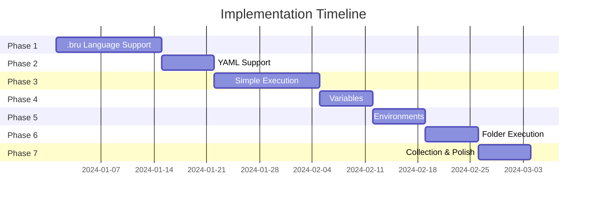
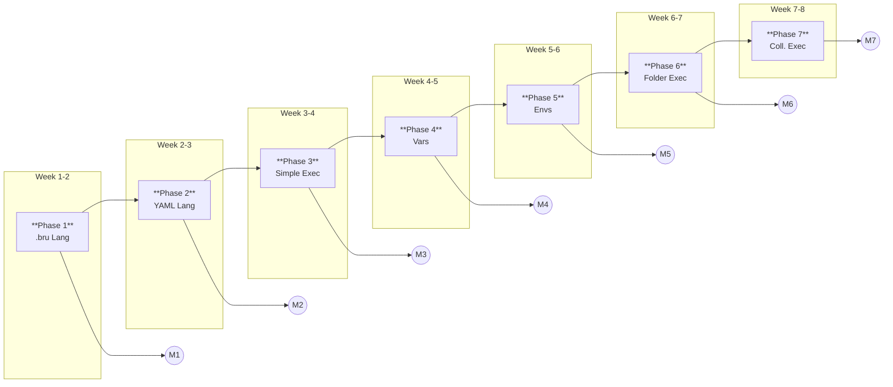
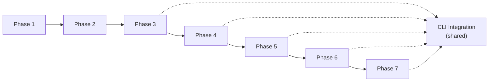

# PLAN.md - Implementation Plan

## Project Overview

**Project:** intelli-bru - IntelliJ Platform Plugin for Bruno API Collections  
**Duration:** 8 weeks (estimated)  
**Start Date:** TBD  
**Version Target:** 1.0.0

---

## Table of Contents

1. [Executive Summary](#executive-summary)
2. [Feature Priority](#feature-priority)
3. [Phase Overview](#phase-overview)
4. [Phase 1: Foundation & .bru Language Support](#phase-1-foundation--bru-language-support)
5. [Phase 2: OpenCollection YAML Support](#phase-2-opencollection-yaml-support)
6. [Phase 3: Simple Request Execution](#phase-3-simple-request-execution)
7. [Phase 4: Variable Management](#phase-4-variable-management)
8. [Phase 5: Environment Management](#phase-5-environment-management)
9. [Phase 6: Folder Execution](#phase-6-folder-execution)
10. [Phase 7: Collection Execution & Polish](#phase-7-collection-execution--polish)
11. [Risk Assessment](#risk-assessment)
12. [Success Criteria](#success-criteria)

---

## Executive Summary

This plan outlines the development of a full-featured IntelliJ IDE plugin for Bruno API collections. The implementation follows an incremental approach, delivering usable functionality at each phase milestone.

### Key Deliverables

| Phase | Deliverable | User Value |
|-------|-------------|------------|
| 1 | .bru syntax highlighting | Edit .bru files with proper highlighting |
| 2 | YAML highlighting | Edit OpenCollection files with validation |
| 3 | Request execution | Run individual API requests |
| 4 | Variable management | Define and use variables |
| 5 | Environment management | Switch between environments |
| 6 | Folder execution | Run request folders |
| 7 | Collection execution | Run complete collections |

---

## Feature Priority

Based on user requirements, features are prioritized as follows:

### P0 - Must Have (MVP)
1. .bru file syntax highlighting
2. OpenCollection YAML syntax highlighting
3. Execute single request
4. View response results

### P1 - Important
5. Variable interpolation display
6. Environment selection
7. Environment variable management
8. Execute folder recursively

### P2 - Nice to Have
9. Execute entire collection
10. Run configuration persistence
11. Tag-based filtering
12. Results export (JSON/JUnit/HTML)

### P3 - Future
13. Request editing UI
14. Environment editing UI
15. Bruno desktop integration
16. Code completion for variables

---

## Phase Overview

### Milestones

| Milestone | Name | Criteria |
|-----------|------|----------|
| M1 | Language Alpha | .bru files open with highlighting |
| M2 | Dual Format Support | Both .bru and YAML highlighted |
| M3 | First Run | Single request executes successfully |
| M4 | Variables Work | {{var}} interpolation visible |
| M5 | Environments Work | Can switch environments |
| M6 | Batch Runs | Folders execute recursively |
| M7 | Release Candidate | Full collection execution |

---

## Phase 1: Foundation & .bru Language Support

**Duration:** 2 weeks  
**Goal:** Open .bru files in IntelliJ with proper syntax highlighting

### Week 1: Project Setup & Lexer

#### Tasks

- [ ] **1.1.1** Configure Grammar-Kit plugin in build.gradle.kts
  - Add grammarkit plugin dependency
  - Configure JFlex and Grammar-Kit versions
  - Set up source generation directories

- [ ] **1.1.2** Create icon resources
  - Design/source .bru file icon (SVG, 16x16)
  - Design/source collection icon (SVG)
  - Design/source folder icon (SVG)
  - Create HTTP method icons (GET, POST, PUT, DELETE, PATCH)
  - Register icons in Icons.kt object

- [ ] **1.1.3** Create BruLanguage class
  - Define language ID "Bru"
  - Set display name "Bruno"
  - Configure case sensitivity (true)

- [ ] **1.1.4** Create BruFileType class
  - Associate with BruLanguage
  - Set extension "bru"
  - Set icon reference
  - Register in plugin.xml

- [ ] **1.1.5** Create JFlex lexer specification (_BruLexer.flex)
  - Define lexer states: YYINITIAL, DICTIONARY, TEXT_BLOCK
  - Define all keyword tokens (40+ block types)
  - Define structural tokens (braces, colon, newline)
  - Handle quoted keys with escape sequences
  - Handle multiline delimiter (''')
  - Handle disabled prefix (~)
  - Handle text content in text blocks

- [ ] **1.1.6** Create token type definitions (BruTokenTypes.kt)
  - Define IElementType for each token
  - Create TokenSet for keywords
  - Create TokenSet for operators
  - Create TokenSet for strings
  - Create TokenSet for comments (if any)

- [ ] **1.1.7** Generate lexer from JFlex spec
  - Run Grammar-Kit JFlex task
  - Verify generated _BruLexer.java
  - Create BruLexerAdapter wrapper

#### Deliverables
- Lexer that tokenizes .bru files correctly
- File type registered and icons visible

### Week 2: Parser & Highlighting

#### Tasks

- [ ] **1.2.1** Create Grammar-Kit BNF grammar (Bru.bnf)
  - Define bruFile as root rule
  - Define all block types (meta, http methods, body variants, etc.)
  - Define dictionary structure
  - Define text block structure
  - Define key-value pairs with optional disable
  - Configure PSI class generation settings

- [ ] **1.2.2** Generate parser from BNF
  - Run Grammar-Kit parser generation
  - Verify generated BruParser.java
  - Verify generated PSI classes

- [ ] **1.2.3** Create BruParserDefinition
  - Implement getFileNodeType()
  - Implement createLexer()
  - Implement createParser()
  - Implement createElement()
  - Implement createFile()
  - Define comment tokens
  - Define whitespace tokens
  - Define string literal tokens

- [ ] **1.2.4** Create highlighting colors (BruHighlightingColors.kt)
  - Define KEYWORD text attributes
  - Define HTTP_GET, HTTP_POST, etc. attributes
  - Define BRACE text attributes
  - Define KEY text attributes
  - Define VALUE text attributes
  - Define DISABLED text attributes
  - Define VARIABLE_REF text attributes
  - Map to DefaultLanguageHighlighterColors fallbacks

- [ ] **1.2.5** Create BruSyntaxHighlighter
  - Map token types to TextAttributesKey
  - Handle keyword highlighting
  - Handle HTTP method-specific colors
  - Handle structural element colors

- [ ] **1.2.6** Create BruSyntaxHighlighterFactory
  - Implement getSyntaxHighlighter()
  - Register in plugin.xml

- [ ] **1.2.7** Create BruColorSettingsPage
  - Define demo text with all constructs
  - Map attribute descriptors to colors
  - Add to Settings > Editor > Color Scheme
  - Register in plugin.xml

- [ ] **1.2.8** Test and verify highlighting
  - Create test .bru files covering all block types
  - Verify keyword highlighting
  - Verify HTTP method colors
  - Verify key-value highlighting
  - Verify disabled item styling
  - Fix any lexer/parser issues

#### Deliverables
- Complete .bru file parsing
- Full syntax highlighting
- User-customizable colors

### Milestone M1 Checklist
- [ ] .bru files open without errors
- [ ] All keywords highlighted correctly
- [ ] HTTP methods have distinct colors
- [ ] Keys and values distinguished
- [ ] Disabled items (~ prefix) appear muted
- [ ] Color scheme page functional
- [ ] No parser errors on valid files

---

## Phase 2: OpenCollection YAML Support

**Duration:** 1 week  
**Goal:** OpenCollection YAML files recognized and highlighted

### Tasks

- [ ] **2.1** Create OpenCollectionFileType
  - Define as YAML-based file type
  - Set icon
  - No extension association (content-based)

- [ ] **2.2** Create OpenCollectionFileTypeDetector
  - Implement detect() method
  - Check for .yml/.yaml extension first
  - Parse first 2KB for structure detection
  - Detect `info:` block with `type:` field
  - Detect `http:`/`graphql:`/`grpc:`/`websocket:` blocks
  - Detect `opencollection.yml` filename
  - Return OpenCollectionFileType or null

- [ ] **2.3** Bundle OpenCollection JSON Schema
  - Copy schema.json to resources/schemas/
  - Rename to opencollection-v1.0.0.json

- [ ] **2.4** Create OpenCollectionSchemaProvider
  - Implement JsonSchemaProviderFactory
  - Create JsonSchemaFileProvider implementation
  - Return bundled schema for detected files
  - Register in plugin.xml

- [ ] **2.5** Create OpenCollectionColors
  - Define HTTP_GET, HTTP_POST, etc. colors
  - Define REQUEST_TYPE color
  - Define VARIABLE_REF color
  - Match colors with .bru highlighting

- [ ] **2.6** Create OpenCollectionAnnotator
  - Implement annotate() for YAMLKeyValue
  - Highlight HTTP methods (method: GET)
  - Highlight request types (type: http)
  - Highlight variable references ({{var}})
  - Register in plugin.xml with language="yaml"

- [ ] **2.7** Test YAML support
  - Create test OpenCollection YAML files
  - Verify file detection works
  - Verify schema validation active
  - Verify HTTP method highlighting
  - Verify variable highlighting
  - Verify code completion from schema

### Milestone M2 Checklist
- [ ] OpenCollection YAML files detected automatically
- [ ] Schema validation provides error highlighting
- [ ] Code completion suggests valid fields
- [ ] HTTP methods colored appropriately
- [ ] Variable references highlighted
- [ ] Both .bru and YAML formats work together

---

## Phase 3: Simple Request Execution

**Duration:** 2 weeks  
**Goal:** Execute a single request and see results

### Week 1: CLI Integration

#### Tasks

- [ ] **3.1.1** Prepare Bruno CLI bundle
  - Download @usebruno/cli package
  - Bundle with Node.js runtime
  - Create ZIP archive for embedding
  - Add to resources/cli/bruno-cli.zip

- [ ] **3.1.2** Create BundledCliManager (application service)
  - Determine plugin data directory path
  - Implement CLI extraction on first use
  - Handle platform differences (Windows/Mac/Linux)
  - Set executable permissions on Unix
  - Implement getVersion() for verification
  - Cache extracted path

- [ ] **3.1.3** Create CliConstants
  - Define exit code constants
  - Define default timeout
  - Define CLI argument names

- [ ] **3.1.4** Create CliExecutor (project service)
  - Define RunOptions data class
  - Build CLI argument list
  - Set working directory to collection root
  - Configure process environment
  - Execute via ProcessBuilder
  - Capture stdout/stderr
  - Wait for completion with timeout
  - Return raw result

- [ ] **3.1.5** Create CliOutputParser
  - Define result data classes (RunResult, RequestResult, etc.)
  - Parse JSON output from --reporter-json
  - Handle missing/malformed JSON gracefully
  - Map to internal models

- [ ] **3.1.6** Test CLI integration
  - Verify CLI extracts correctly
  - Verify simple request executes
  - Verify output parsing works
  - Test on target platforms

### Week 2: Run Configuration & UI

#### Tasks

- [ ] **3.2.1** Create BrunoRunConfigurationType
  - Define configuration type ID
  - Set display name "Bruno Request"
  - Set icon
  - Create configuration factory

- [ ] **3.2.2** Create BrunoRunConfiguration
  - Define configuration fields (targetPath, collectionRoot, etc.)
  - Implement readExternal/writeExternal for persistence
  - Implement checkConfiguration for validation
  - Implement getState to create run state

- [ ] **3.2.3** Create BrunoRunConfigurationOptions
  - Persistent state class for configuration

- [ ] **3.2.4** Create BrunoRunConfigurationEditor
  - File path selector for target
  - Collection root selector
  - Sandbox mode dropdown (safe/developer)
  - Layout with FormBuilder

- [ ] **3.2.5** Create BrunoRunState
  - Implement execute() method
  - Create BrunoProcessHandler
  - Attach console view
  - Return ExecutionResult

- [ ] **3.2.6** Create BrunoProcessHandler
  - Extend ProcessHandler
  - Start CLI process
  - Stream output to console
  - Handle process termination
  - Parse results on completion

- [ ] **3.2.7** Create BrunoConsoleView
  - Extend TextConsoleBuilderImpl
  - Add colored output support
  - Add hyperlink support for files

- [ ] **3.2.8** Create RunRequestAction
  - Context action for .bru and YAML files
  - Find collection root from file
  - Create/update run configuration
  - Execute immediately
  - Add keyboard shortcut (Ctrl+Shift+R)
  - Register in plugin.xml

- [ ] **3.2.9** Create simple ResultsPanel (Compose)
  - Display exit code
  - Display summary counts
  - Display raw console output
  - Show success/failure status

- [ ] **3.2.10** Create ResultsToolWindowFactory
  - Register tool window (bottom anchor)
  - Show ResultsPanel content
  - Update on run completion

- [ ] **3.2.11** Test complete flow
  - Run request via context menu
  - Run request via keyboard shortcut
  - Run request via run configuration
  - Verify results display
  - Test failure scenarios

### Milestone M3 Checklist
- [ ] Can run single .bru request file
- [ ] Can run single OpenCollection YAML request
- [ ] Console shows execution output
- [ ] Results panel shows summary
- [ ] Run configuration saved and reusable
- [ ] Context menu action works
- [ ] Keyboard shortcut works

---

## Phase 4: Variable Management

**Duration:** 1 week  
**Goal:** Variables display correctly in files and interpolate during execution

### Tasks

- [ ] **4.1** Create BruAnnotator for variable highlighting
  - Detect {{variableName}} pattern in values
  - Apply VARIABLE_REF highlighting
  - Handle nested braces correctly
  - Register in plugin.xml

- [ ] **4.2** Update OpenCollectionAnnotator for variables
  - Enhance existing variable detection
  - Highlight in URL, headers, body fields
  - Handle YAML multiline strings

- [ ] **4.3** Create VariableModel data class
  - uid, name, value fields
  - enabled, local, secret flags
  - Parse from .bru vars blocks
  - Parse from YAML variables arrays

- [ ] **4.4** Create VariableService (project service)
  - Parse variables from request files
  - Parse variables from folder settings
  - Parse variables from collection settings
  - Build variable hierarchy
  - Resolve variable references

- [ ] **4.5** Update CollectionService for variables
  - Extract vars:pre-request blocks
  - Extract vars:post-response blocks
  - Store in request/folder models

- [ ] **4.6** Create VariableQuickInfo
  - Show variable value on hover
  - Indicate variable source (request/folder/collection/env)
  - Handle undefined variables

- [ ] **4.7** Add variable display to ResultsPanel
  - Show pre-request variable values
  - Show post-response variable captures
  - Highlight variable changes

- [ ] **4.8** Test variable management
  - Verify variable highlighting in .bru files
  - Verify variable highlighting in YAML files
  - Verify hover shows value
  - Verify execution uses variables

### Milestone M4 Checklist
- [ ] {{variable}} references highlighted
- [ ] Hover shows variable value and source
- [ ] Variables from request file used in execution
- [ ] Variables from folder/collection inherited
- [ ] Pre/post-response variables captured in results

---

## Phase 5: Environment Management

**Duration:** 1 week  
**Goal:** Select and switch between environments

### Tasks

- [ ] **5.1** Create EnvironmentModel data class
  - uid, name, path fields
  - color optional field
  - variables list
  - secretVariables list (names only)

- [ ] **5.2** Create EnvironmentService (project service)
  - Discover environments in collection
  - Parse .bru environment files
  - Parse YAML environment files
  - Store selected environment per project
  - Emit state changes via StateFlow

- [ ] **5.3** Update CollectionService
  - Scan environments/ directory
  - Load environment list per collection
  - Watch for environment file changes

- [ ] **5.4** Create EnvironmentSelector (Compose component)
  - Dropdown with environment names
  - "None" option for no environment
  - Color indicator if defined
  - On selection, update EnvironmentService

- [ ] **5.5** Create CollectionExplorerFactory
  - Basic tool window structure
  - Toolbar with EnvironmentSelector
  - Placeholder for collection tree

- [ ] **5.6** Update BrunoRunConfiguration
  - Add environment field
  - Add to configuration editor
  - Pass --env argument to CLI

- [ ] **5.7** Update CliExecutor
  - Include --env argument when set
  - Handle environment file path resolution

- [ ] **5.8** Update ResultsPanel
  - Show active environment name
  - Show environment variables used

- [ ] **5.9** Test environment management
  - Verify environments discovered
  - Verify selector shows all environments
  - Verify selection persists
  - Verify execution uses selected environment
  - Verify switching environment works

### Milestone M5 Checklist
- [ ] Environments discovered automatically
- [ ] Environment selector in tool window
- [ ] Selection persisted per project
- [ ] Execution uses selected environment
- [ ] Environment variables override request variables
- [ ] Results show which environment was used

---

## Phase 6: Folder Execution

**Duration:** 1 week  
**Goal:** Execute all requests in a folder recursively

### Tasks

- [ ] **6.1** Create CollectionTreeModel
  - Hierarchical model from CollectionService
  - Support expansion/collapse state
  - Support selection state
  - Emit changes reactively

- [ ] **6.2** Create FolderModel enhancements
  - items list (nested requests/folders)
  - root settings (folder.bru / folder.yml)
  - Compute request count recursively

- [ ] **6.3** Create HttpMethodBadge (Compose component)
  - Colored badge for HTTP method
  - GET: blue, POST: green, PUT: orange, DELETE: red, PATCH: teal
  - Compact display (method text + background)

- [ ] **6.4** Create RequestNode (Compose component)
  - HttpMethodBadge + request name
  - Click to open file
  - Context menu for run action
  - Run button on hover

- [ ] **6.5** Create FolderNode (Compose component)
  - Folder icon + name
  - Expand/collapse chevron
  - Request count badge
  - Context menu for run folder action
  - Recursive rendering of children

- [ ] **6.6** Create CollectionNode (Compose component)
  - Collection icon + name
  - Environment indicator
  - Child folders and requests

- [ ] **6.7** Update CollectionExplorerPanel
  - Replace placeholder with CollectionTree
  - Implement tree navigation
  - Handle empty state
  - Add loading indicator

- [ ] **6.8** Create RunFolderAction
  - Context action for folders
  - Create run configuration with -r flag
  - Execute all requests in folder
  - Register in plugin.xml

- [ ] **6.9** Update BrunoRunConfiguration
  - Add recursive flag
  - Pass -r argument to CLI

- [ ] **6.10** Update ResultsPanel for multiple requests
  - List all request results
  - Expandable result cards
  - Summary across all requests
  - Filter by status (pass/fail/skip)

- [ ] **6.11** Create RequestResultCard (Compose component)
  - Status icon (pass/fail/skip/error)
  - Request name and path
  - Response status and time
  - Expandable details section
  - Test results list
  - Assertion results list
  - Error message if failed

- [ ] **6.12** Test folder execution
  - Run folder with multiple requests
  - Verify all requests execute
  - Verify recursive execution
  - Verify results aggregation
  - Test mixed success/failure

### Milestone M6 Checklist
- [ ] Collection tree displays in tool window
- [ ] Folders expandable/collapsible
- [ ] Requests show HTTP method badges
- [ ] Can run entire folder via context menu
- [ ] All requests in folder execute recursively
- [ ] Results show all request outcomes
- [ ] Summary shows aggregate counts

---

## Phase 7: Collection Execution & Polish

**Duration:** 1 week  
**Goal:** Execute complete collections and finalize for release

### Tasks

- [ ] **7.1** Create RunCollectionAction
  - Run all requests in collection root
  - Create run configuration for collection
  - Execute with -r from root
  - Register in plugin.xml

- [ ] **7.2** Add tag filtering support
  - Add tags field to run configuration
  - Add exclude tags field
  - Pass --tags and --exclude-tags to CLI
  - Update configuration editor UI

- [ ] **7.3** Add tests-only mode
  - Add testsOnly field to run configuration
  - Pass --tests-only to CLI
  - Update configuration editor UI

- [ ] **7.4** Add bail mode (stop on failure)
  - Add bail field to run configuration
  - Pass --bail to CLI
  - Update configuration editor UI

- [ ] **7.5** Create BrunoSettings (project service)
  - Default sandbox mode preference
  - Default environment preference
  - Show/hide HTTP method badges
  - Auto-detect collections setting

- [ ] **7.6** Create BrunoSettingsConfigurable
  - Settings UI under Tools > Bruno
  - CLI path override option
  - Default preferences
  - Register in plugin.xml

- [ ] **7.7** Add results export
  - Export to JSON button
  - Export to JUnit XML button
  - File chooser dialog
  - Use CLI reporter options or local export

- [ ] **7.8** Create OpenInBrunoAction
  - Open collection in Bruno desktop app
  - Detect Bruno installation
  - Pass collection path
  - Register in plugin.xml

- [ ] **7.9** Add error notifications
  - Notify on CLI extraction failure
  - Notify on execution errors
  - Notify on environment not found
  - Use Bruno notification group

- [ ] **7.10** Update AGENTS.md with plugin info
  - Add plugin development section
  - Document how to build plugin
  - Document test commands

- [ ] **7.11** Create README.md for plugin
  - Feature overview
  - Installation instructions
  - Usage guide
  - Screenshots

- [ ] **7.12** Final testing and bug fixes
  - Test all features end-to-end
  - Test on Windows, macOS, Linux
  - Fix any remaining issues
  - Performance testing

- [ ] **7.13** Prepare release artifacts
  - Build plugin ZIP
  - Verify plugin verification passes
  - Create changelog
  - Tag release version

### Milestone M7 Checklist
- [ ] Can run entire collection
- [ ] Tag filtering works
- [ ] Tests-only mode works
- [ ] Bail mode works
- [ ] Settings page complete
- [ ] Results exportable
- [ ] Error handling robust
- [ ] Documentation complete
- [ ] Plugin builds successfully
- [ ] Ready for initial release

---

## Risk Assessment

### Technical Risks

| Risk | Probability | Impact | Mitigation |
|------|-------------|--------|------------|
| Grammar-Kit learning curve | Medium | Medium | Allocate extra time in Phase 1, study examples |
| CLI bundling complexity | Medium | High | Test early on all platforms, have fallback to npx |
| Compose/Jewel limitations | Low | Medium | Fall back to Swing if needed |
| IntelliJ API changes | Low | Medium | Pin to stable API, avoid internal APIs |
| Performance with large collections | Medium | Medium | Implement lazy loading, pagination |

### Schedule Risks

| Risk | Probability | Impact | Mitigation |
|------|-------------|--------|------------|
| Parser development takes longer | Medium | High | Start with simplified grammar, iterate |
| CLI integration issues | Medium | Medium | Have Bruno team contact for support |
| Testing delays | Medium | Low | Automate tests, use CI |

### Resource Risks

| Risk | Probability | Impact | Mitigation |
|------|-------------|--------|------------|
| Bruno CLI updates | Medium | Low | Pin to specific version initially |
| Schema changes | Low | Low | Bundle schema, version independently |

---

## Success Criteria

### Phase Success Criteria

| Phase | Success Criteria |
|-------|------------------|
| Phase 1 | All .bru files open with full syntax highlighting, no parser errors |
| Phase 2 | OpenCollection YAML files detected and validated against schema |
| Phase 3 | Single request executes via CLI with results visible |
| Phase 4 | Variables resolve correctly across request/folder/collection hierarchy |
| Phase 5 | Environment selection changes execution behavior correctly |
| Phase 6 | Folder execution runs all nested requests with aggregated results |
| Phase 7 | Complete collection execution, settings, export, and documentation |

### Release Criteria

- [ ] All P0 features complete and tested
- [ ] All P1 features complete and tested
- [ ] No critical bugs
- [ ] Plugin verification passes
- [ ] Documentation complete
- [ ] Tested on IntelliJ IDEA 2025.2.4+
- [ ] Tested on Windows, macOS, Linux

---

## Appendix: Detailed Task Breakdown

### Complete Task List by Phase

```mermaid
flowchart TB
    subgraph P1["Phase 1 (18 tasks)"]
        direction TB
        P1W1["**Week 1 (7 tasks)**<br/>Setup, Icons, Language,<br/>FileType, Lexer, Tokens, Generate"]
        P1W2["**Week 2 (11 tasks)**<br/>BNF, Generate Parser, ParserDef,<br/>Colors, Highlighter, Factory,<br/>ColorPage, Testing"]
        P1W1 --> P1W2
    end
    
    subgraph P2["Phase 2 (7 tasks)"]
        P2T["FileType, Detector, Schema,<br/>SchemaProvider, Colors,<br/>Annotator, Testing"]
    end
    
    subgraph P3["Phase 3 (21 tasks)"]
        direction TB
        P3W1["**Week 1 (6 tasks)**<br/>CLI Bundle, CliManager,<br/>Constants, Executor, Parser, Testing"]
        P3W2["**Week 2 (15 tasks)**<br/>ConfigType, Config, Options, Editor,<br/>State, Handler, Console, Action,<br/>Results, ToolWindow, Testing"]
        P3W1 --> P3W2
    end
    
    subgraph P4["Phase 4 (8 tasks)"]
        P4T["Annotator, YAML update, Model,<br/>Service, Collection update,<br/>QuickInfo, Results update, Testing"]
    end
    
    subgraph P5["Phase 5 (9 tasks)"]
        P5T["Model, Service, Collection update,<br/>Selector, Explorer, Config update,<br/>Executor update, Results update, Testing"]
    end
    
    subgraph P6["Phase 6 (12 tasks)"]
        P6T["TreeModel, FolderModel, Badge,<br/>RequestNode, FolderNode, CollectionNode,<br/>Explorer update, Action, Config update,<br/>Results update, ResultCard, Testing"]
    end
    
    subgraph P7["Phase 7 (13 tasks)"]
        P7T["CollectionAction, Tags, TestsOnly,<br/>Bail, Settings, Configurable, Export,<br/>OpenInBruno, Notifications,<br/>AGENTS.md, README, Testing, Release"]
    end
    
    P1 --> P2 --> P3 --> P4 --> P5 --> P6 --> P7
```

**Total: 88 tasks across 7 phases**

### Dependency Graph

---

## Revision History

| Version | Date | Author | Changes |
|---------|------|--------|---------|
| 1.0 | TBD | - | Initial plan |
